# The Last Seat

Team formation for a hackathon with 10,000 participants, built so that a seat can only be claimed once.
When 50 people hit "join" on a team with one free seat in the same instant, exactly one gets it and 49 get a clean `409`.

- **One-page design doc:** [DESIGN.md](DESIGN.md) (the long version: [docs/ARCHITECTURE.md](docs/ARCHITECTURE.md))
- **Performance:** [PERFORMANCE_AUDIT.md](PERFORMANCE_AUDIT.md) (profiling, changes, Lighthouse before and after)
- **Load test numbers:** [LOAD_TEST.md](LOAD_TEST.md) (local), [LOAD_TEST_REMOTE.md](LOAD_TEST_REMOTE.md) (live, 10/50/100 users), [LOAD_TEST_REGIONAL.md](LOAD_TEST_REGIONAL.md) (live, server-side time)
- **Visual direction:** [DESIGN_BRIEF.md](DESIGN_BRIEF.md)
- **Live:** https://last-seat-sg.onrender.com (Render free tier in Singapore, MongoDB Atlas M0; the first request after a quiet period can take about a minute while the instance wakes)

## Against the brief

| Requirement | Where it is |
| --- | --- |
| Rules: min/max size, one team per person, expiring codes, leader handover, last member deletes the team | [`src/teams.js`](src/teams.js), [`test/rules.test.js`](test/rules.test.js) |
| Race-proof, proved by a 50-way concurrency test | [`test/races.test.js`](test/races.test.js) (and a test of the test: delete the guard line and 40 win) |
| Idempotent, including concurrent duplicates and a crash | [`test/idempotency.test.js`](test/idempotency.test.js), [`test/chaos.test.js`](test/chaos.test.js) |
| Real time, no refresh | server-sent events with replay: [`src/events.js`](src/events.js) |
| Secure: auth, leader-only, brute-force limits, validation | [`src/http.js`](src/http.js), [`src/app.js`](src/app.js), tests in `rules` and `limits-realtime-suggestions` |
| Audit log | written in the same transaction, `GET /api/teams/:id/audit` (leader only) |
| Suggestions with the scoring explained | [`src/suggestions.js`](src/suggestions.js), formula in [DESIGN.md](DESIGN.md), unit-tested |
| 20+ tests in CI; seed; load test | `npm test` (87), [CI](.github/workflows/ci.yml), `npm run seed`, [LOAD_TEST.md](LOAD_TEST.md) |
| React UI, phone and keyboard only | [`web/`](web/); the browser test drives a keyboard-only flow |
| Live URL | https://last-seat-sg.onrender.com |
| Bonus: optimistic UI + rollback, Compose, metrics, chaos test | request-to-join and accept/decline are optimistic and roll back on a conflict; the browser test asserts the rollback (`scripts/e2e.js`, and it fails if the rollback is removed); [`docker-compose.yml`](docker-compose.yml); `GET /metrics`; [`test/chaos.test.js`](test/chaos.test.js) |

## Run it

One command, whole stack (UI, API and a MongoDB replica set):

```bash
docker compose up --build            # http://localhost:4000
```

The compose file validates (`docker compose config`) and the image's contents were checked by running the server from a clean copy with production dependencies only, but I could not run `docker compose up` end to end: Docker Desktop's engine would not start on the machine this was built on. If it misbehaves, use the manual steps below, which are what every test and measurement here used.

Manually:

Needs Node 20.12+ and any MongoDB **replica set** (transactions do not work on a standalone server); Docker is the easiest way to get one.

```bash
docker compose up -d                 # single-node MongoDB replica set on 127.0.0.1:27017
cp .env.example .env                 # then set JWT_SECRET and SEED_PASSWORD (the file says how)
npm install && npm run build         # installs the server, builds the UI into web/dist
npm run seed                         # 10,000 users, 2,000 teams
npm start                            # http://localhost:4000
```

Log in as `seed-00001@seed.invalid` with your `SEED_PASSWORD`, or sign up.

## Scripts

| Command | What it does |
| --- | --- |
| `npm start` / `npm run dev` | API (and the built UI, if `web/dist` exists) on `PORT` |
| `npm run dev:web` | Vite dev server for the UI, proxying `/api` to `PORT` |
| `npm test` | 87 tests over real HTTP against a real MongoDB replica set (started automatically), including the chaos test that kills the server |
| `npm run test:e2e -- http://localhost:4000` | Drives the real UI in your installed Chrome against a running app: signup, create team, live update, two browsers racing for the last seat, the optimistic "Request to join" rolling back when the team fills first, keyboard and reduced-motion checks. Saves the screenshots below |
| `npm run lint` / `npm run typecheck` | ESLint for the server, oxlint and `tsc` for the UI |
| `npm run seed` | Inserts `SEED_USERS` users and `SEED_TEAMS` teams; safe to re-run |
| `npm run loadtest` | autocannon against the board endpoint; writes `LOAD_TEST.md` |
| `npm run loadtest:steps -- <url> <label>` | 10/50/100 users, paced and flat out, client latency and server time from `Server-Timing`; writes `docs/loadtest/<label>.json` |
| `bash scripts/lighthouse.sh <url> <label>` | Lighthouse on landing and board, desktop and mobile, median of 5 runs; reports in `docs/lighthouse/` |
| `npm run race -- <url> 50` | The headline scenario against any running instance: N people press join on a team with one free seat |
| `npm run capacity` | probes where one process bends: signup bursts, 50/100/250-way races, 10,000 open live connections, suggestions throughput |

## What the tests cover

Nothing is mocked. Each test file boots the app on a real port against its own database.

| File | Tests | Covers |
| --- | --- | --- |
| `test/races.test.js` | 15 | 50 users for one seat (5 rounds), double-click, one user joining two teams, two accepts for the last seat, the same request accepted twice, leader leaving during joins, last member leaving during a join |
| `test/idempotency.test.js` | 9 | replay, 20 concurrent duplicates, replayed errors, key reuse, per-user scope, crashed-request recovery, signup replay |
| `test/rules.test.js` | 30 | auth, validation, min/max, invite expiry and regeneration, leader-only actions, requests, leadership transfer, team deletion, audit log, board pagination and query plan |
| `test/limits-realtime-suggestions.test.js` | 16 | rate limits (wrong guesses trip them, a valid crowd does not), SSE delivery, replay and reset, suggestion scoring |
| `test/operations.test.js` | 8 | metrics, the board fast path and its rate-limit exemption, password-hash compatibility, suggestion freshness, the atomic idempotency record |
| `test/chaos.test.js` | 1 | the real server is `SIGKILL`ed mid-burst of 90 joins, restarted, every request retried with its key: no corruption, no duplicates, nobody lost, committed-but-unanswered joins replayed |

## Architecture

```
src/
  config.js        every setting, from env, validated with zod at startup (no in-code defaults)
  db.js            connection, indexes, withTxn (bounded retries on write conflicts)
  teams.js         the domain: claimSeat, join, leave, transfer, requests, audit
  idempotency.js   Idempotency-Key middleware
  events.js        SSE bus with event ids and a replay buffer
  suggestions.js   scoring (pure function) and the two ranking queries
  http.js          errors, validation helper, session cookie
  app.js           routes
web/src/           React + Vite + TypeScript UI (three.js sky is lazy-loaded in its own chunk)
scripts/           seed and load test
```

One Node process serves the API, the event stream and the built UI from one origin, so cookies and SSE need no CORS setup.

## API

All bodies are JSON. Errors are `{ "error": { "code", "message", "details"? }, "requestId" }`. Mutations accept `Idempotency-Key`.

| Method and path | Who | Purpose |
| --- | --- | --- |
| `POST /api/auth/signup`, `/login`, `/logout` | anyone | session cookie |
| `GET /api/me`, `GET /api/meta` | anyone | current user (or null), skills and hackathon |
| `GET /api/hackathons/:id/teams?cursor&limit&skill` | anyone | the board: open teams, newest first |
| `GET /api/hackathons/:id/events` | anyone | server-sent events |
| `POST /api/hackathons/:id/teams` | user | create a team, returns the invite code once |
| `POST /api/invites/redeem` | user | join instantly with a code |
| `GET /api/hackathons/:id/me` | user | my team and pending requests |
| `GET /api/hackathons/:id/suggestions?kind=people\|teams` | user | ranked matches with a score breakdown |
| `GET /api/teams/:id` | user | team and members |
| `POST /api/teams/:id/requests` | user | ask to join |
| `POST /api/requests/:id/cancel` | requester | withdraw a request |
| `GET /api/teams/:id/requests`, `POST /api/requests/:id/accept\|decline` | leader | inbox |
| `POST /api/teams/:id/invite` | leader | new invite code (the old one stops working) |
| `DELETE /api/teams/:id/members/:userId` | leader | remove a member |
| `POST /api/teams/:id/leave` | member | leave; leadership transfers; last member deletes the team |
| `GET /api/teams/:id/audit` | leader | team history |

## Deploy (free tier)

Deployed at https://last-seat-sg.onrender.com. To redo it from scratch:

1. **MongoDB Atlas**: create a free M0 cluster (it is a replica set), a database user, and allow access from anywhere. Copy the `mongodb+srv://` connection string.
2. **Render**: New → Blueprint → pick this repository. `render.yaml` defines the service. Fill in the two prompted values: `MONGODB_URI` (from step 1) and `SEED_PASSWORD`. `JWT_SECRET` is generated for you.
3. Open the URL Render gives you. Check `GET /api/health` returns `{"status":"ok"}`, sign up, create a team, and open the board in a second browser to watch it update.
4. Optional: run `npm run seed` locally with `MONGODB_URI` pointing at Atlas to fill the board.

Free instances sleep when idle; the first request after a pause takes about a minute. Seed the Atlas database from your own machine with `MONGODB_URI` set in your shell (never commit it).

## Screenshots

Captured by `npm run test:e2e` from the running app (seeded data plus the accounts the test creates).

| Landing | Landing after scrolling: points gathered into constellations |
| --- | --- |
| 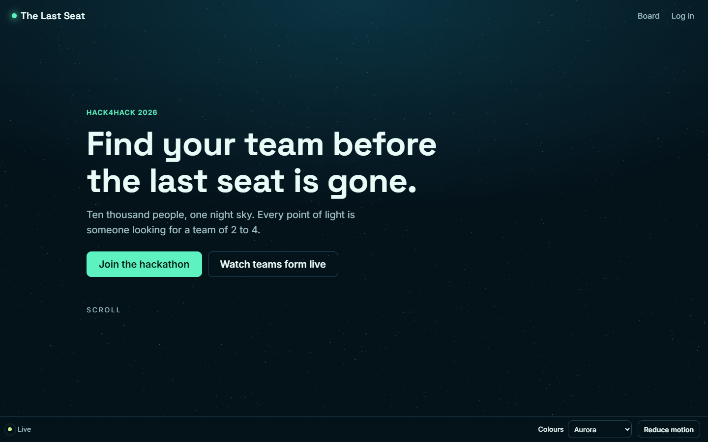 | 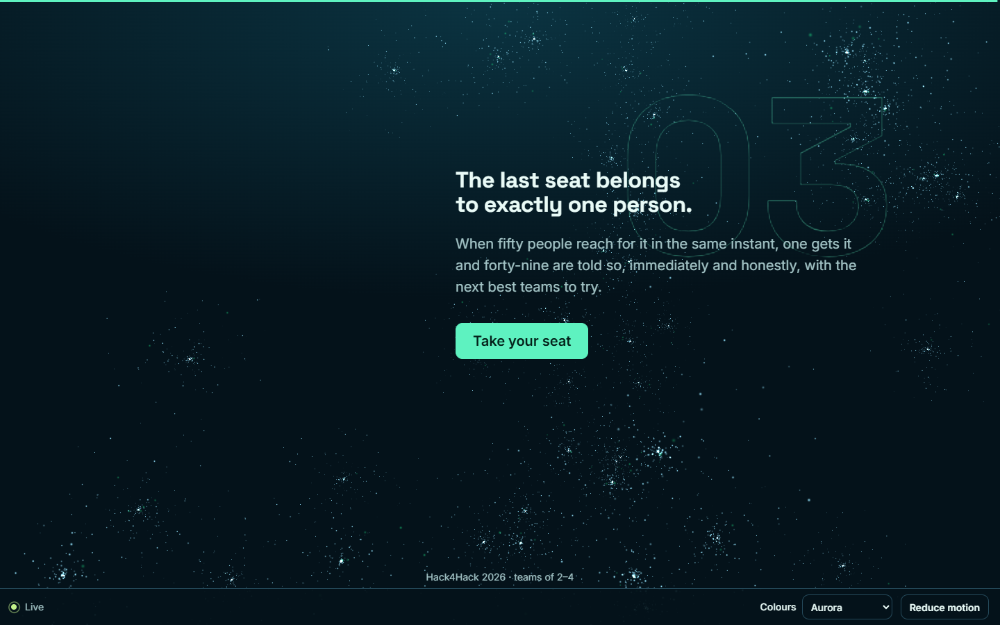 |

| Board, with "Last seat" teams | Team page: constellation, inbox, invite code |
| --- | --- |
| 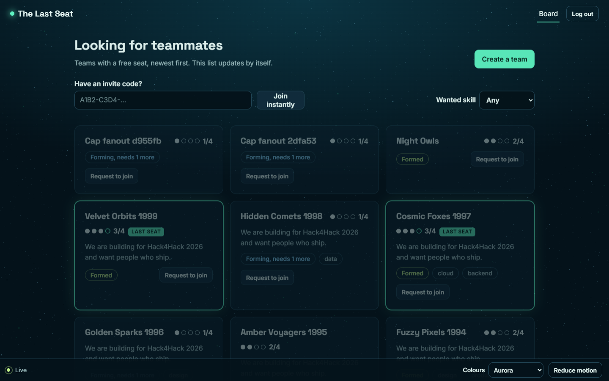 | 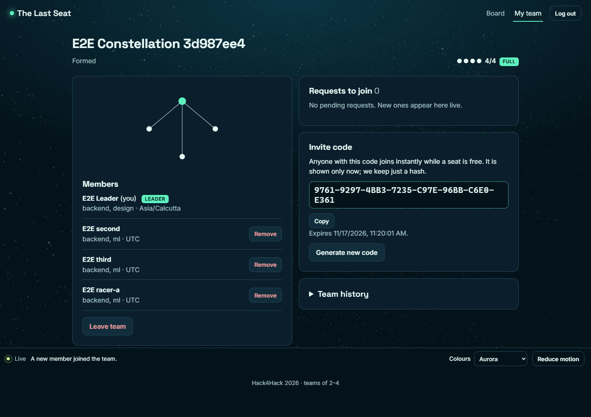 |

| Losing the race (phone) | Board (phone) | Landing (phone) | Reduced motion |
| --- | --- | --- | --- |
| 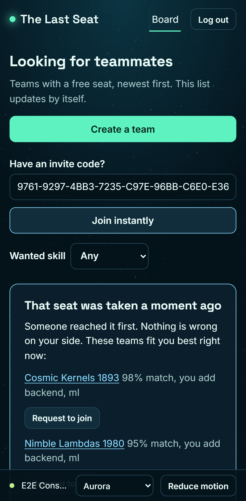 | 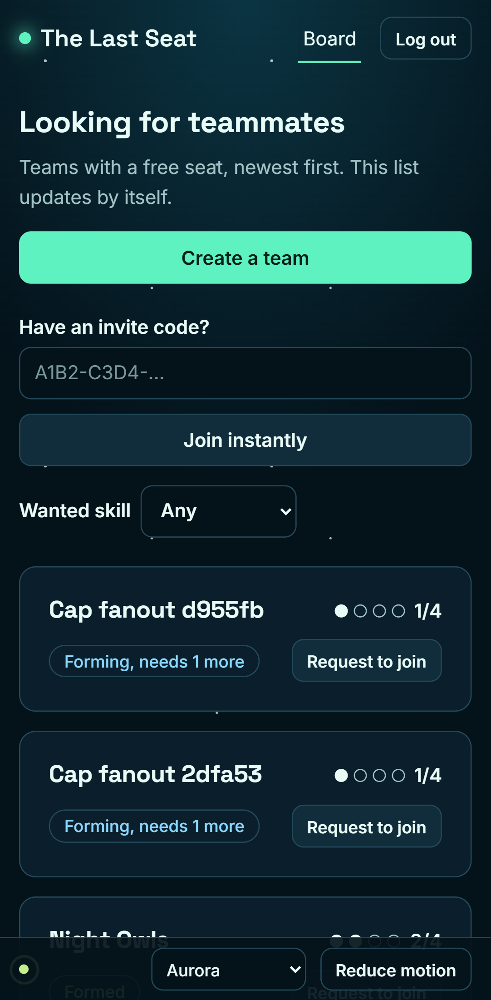 | 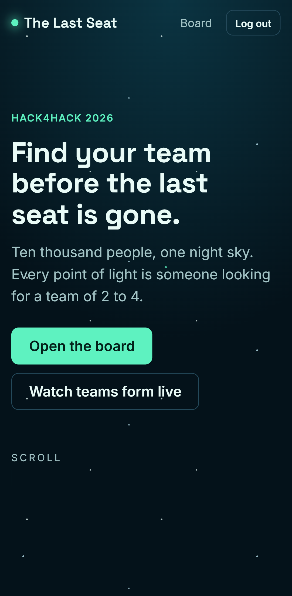 | 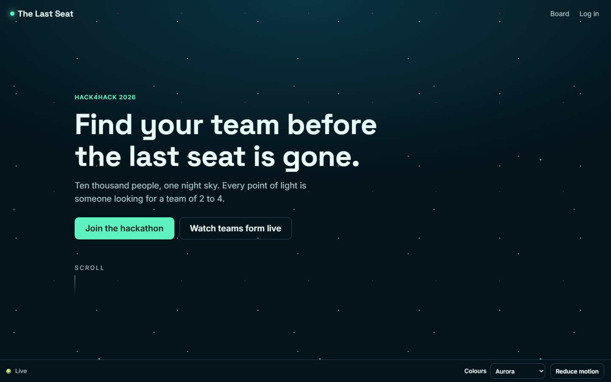 |

### Colour palettes

Four palettes, switchable from the "Colours" menu in the status bar (the choice is remembered). The 3D sky reads
its star colours from the same CSS tokens, so it changes with the palette. Aurora is the default.

| Aurora | Midnight gold | Nebula | Ember |
| --- | --- | --- | --- |
| 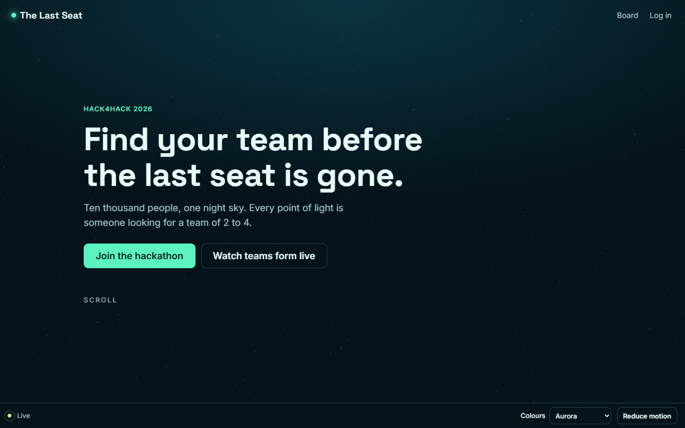 | 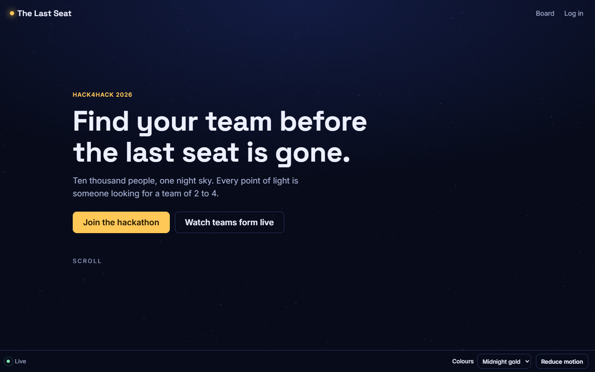 | 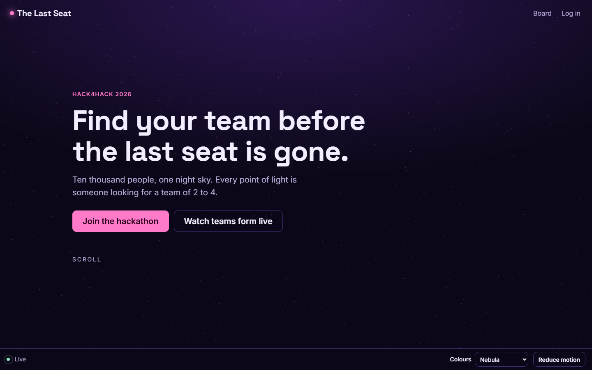 | 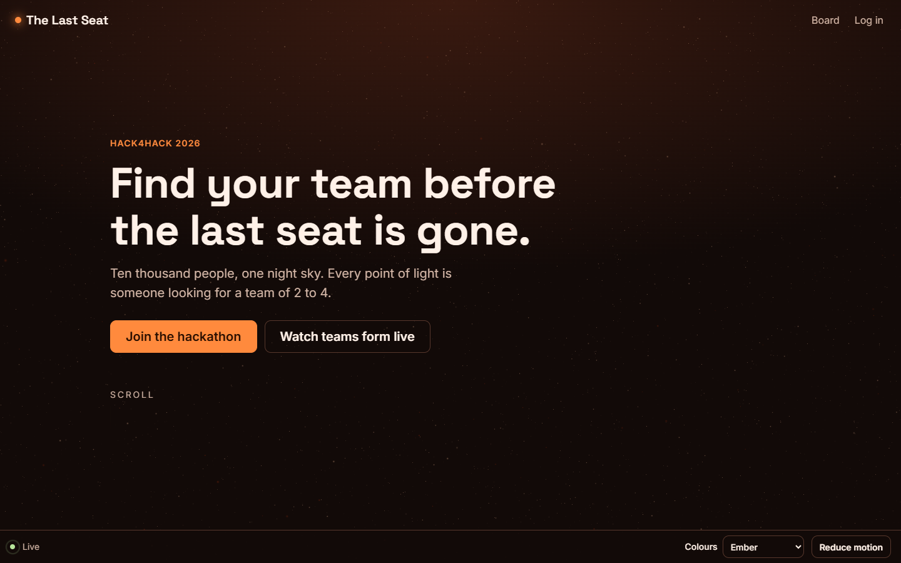 |
| 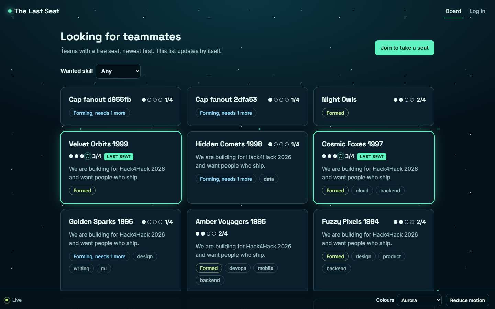 | 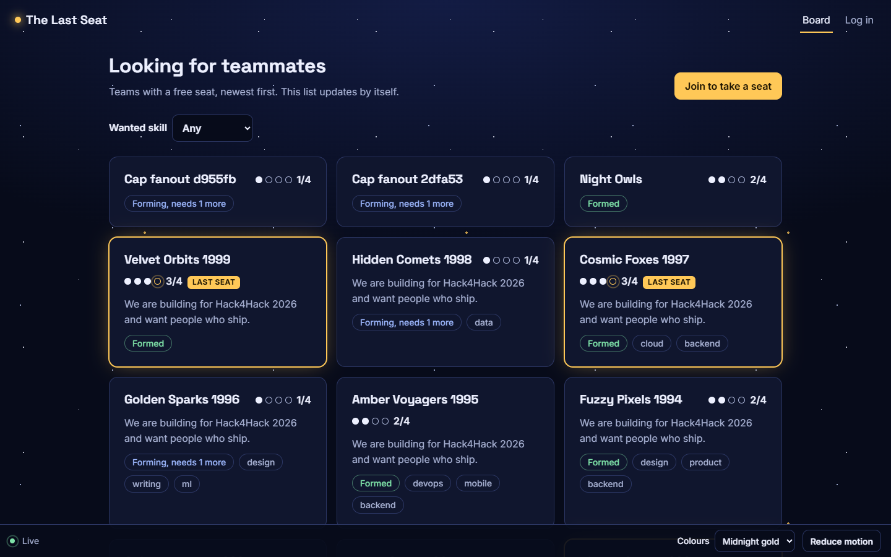 | 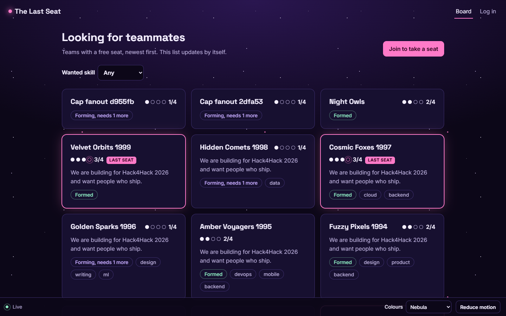 | 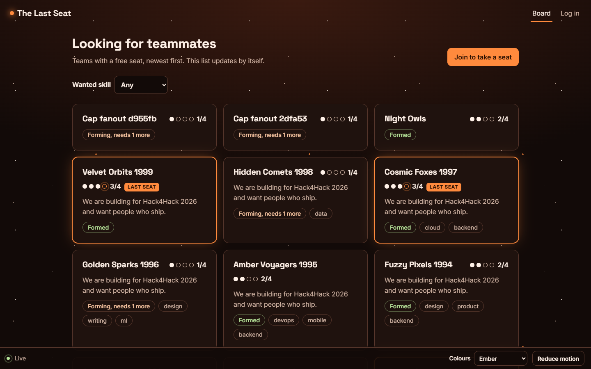 |

### Scroll story

The landing page is driven by scroll position: a progress bar, a hero that recedes, story sections that slide in
with a numeral drifting behind them, the camera moving into the sky, and a pinned scene where scrolling fills a
team's seats one at a time until the last one is taken.

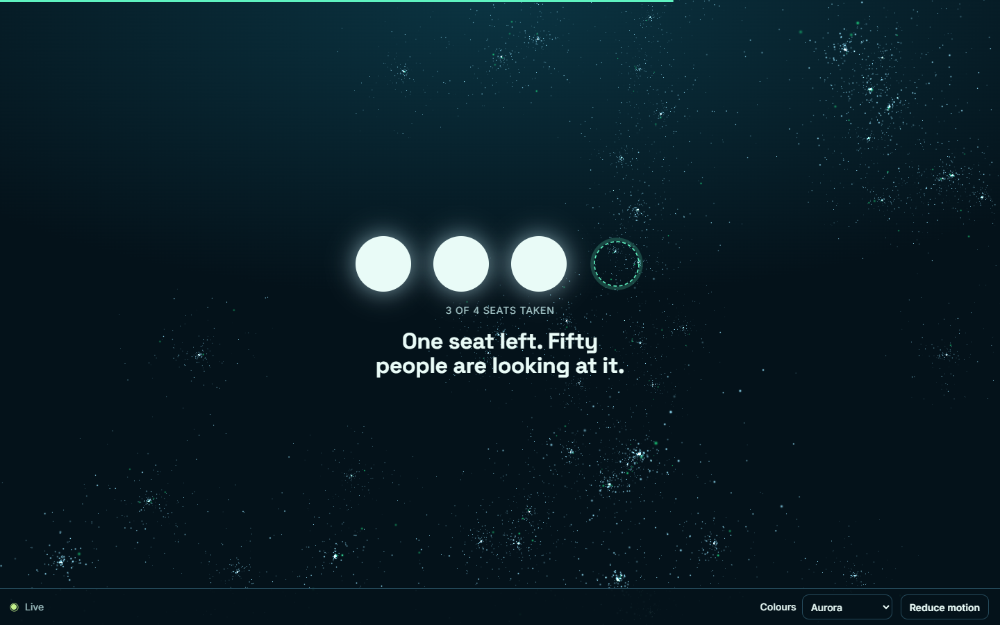

## Measured

### Deployed (Render free tier in Singapore + MongoDB Atlas M0 in India)

Everything below was measured from one laptop in India against the live URL, with nothing raised or switched off.

**Correctness under concurrency, live** (`npm run race -- https://last-seat-sg.onrender.com <n>`, all racers from one machine):

| Racers for one free seat | `200` | `409 team_full` | 5xx / throttled / dropped | Team afterwards | Response time |
| --- | --- | --- | --- | --- | --- |
| 50 | 1 | 49 | 0 | 4 of 4 members, 4 rows | 1.1 to 4.4 s |
| 100 | 1 | 99 | 0 | 4 of 4 members, 4 rows | 1.3 to 5.8 s |
| 100 (re-run 2026-11-14) | 1 | 93 | 6 client connect timeouts (the laptop opening 100 TLS connections at once; no request reached the server) | 4 of 4 members, 4 rows | 1.0 to 10.9 s |

One uncontended join takes about 0.5 s, creating a team 0.6 s, a signup 0.6 s.

**The browser test passes against the live site** (`npm run test:e2e -- https://last-seat-sg.onrender.com`): signup, create a team, a live
update without reload, two browsers pressing "Join instantly" together (one joined, one saw the "seat was taken" panel),
a keyboard-only login, create-team and leave flow, reduced motion, all four palettes.

**Load test, live** ([LOAD_TEST_REMOTE.md](LOAD_TEST_REMOTE.md), 2026-11-14, 0 failed requests out of 19,300):

| Users | Paced (about 1 request/s each): client p95 | Flat out: client p95, req/s | Server time p95 (`Server-Timing`) |
| ---: | ---: | ---: | ---: |
| 10 | 511 ms (TLS setup, see below) | 362 ms, 74 | 63–66 ms |
| 50 | **143 ms** | 369 ms, 347 | 52–91 ms |
| 100 | **145 ms** | 590 ms, 379 | 47–97 ms |

- At a realistic pace, 50 and 100 users meet p95 < 200 ms from a laptop in India. About 85 ms of every request is the
  network round trip: the client p50 is that at every load, while the server's p50 is a cache hit.
- The 10-user figure is connection setup. A new HTTPS connection costs 0.45–0.59 s of TLS here, and 10 first
  connections out of 197 requests is exactly the 5% that p95 looks at.
- Flat out, the free instance's CPU share is the limit: the server-side p95 stays under 100 ms, while requests queue
  in front of it.
- The server-side view, which is what a client in the region would add only its own round trip to, is in
  [LOAD_TEST_REGIONAL.md](LOAD_TEST_REGIONAL.md). The same code locally: about 7,200 req/s at 100 connections, p95 21 ms.

**Lighthouse, live** (median of 5 runs each; all runs and reports in [PERFORMANCE_AUDIT.md](PERFORMANCE_AUDIT.md)):
landing **100** on desktop and **91** on mobile; board **96** on desktop and **86** on mobile. Accessibility, best
practices and SEO are 100 on every page. The board on mobile is the one score under 90: what is left is React's own
first render, about 280 ms under 4× CPU throttling.

**What moving regions did.** The first deployment ran in Oregon while the database is in India, about 240 ms apart, and a
join makes about eight database calls. There, one join took 2.1 s and the 50-way race 7.4 to 10.7 s. Moving the server
next to the database (same code) brought those to 0.5 s and 1.1 to 4.4 s.

**Two bugs found only by testing the live site,** both fixed and covered by tests: per-address rate limits were keyed on
proxy addresses until `TRUST_PROXY` was set to the measured depth (3), and the invite limiter counted valid attempts
instead of wrong guesses, which throttled 22 of 50 racers coming from one machine.

### Local production build

Lighthouse 13.6.0, median of 5 runs, against the production build served by `npm start`.

| Page | Desktop | Mobile | Accessibility | Best practices | Mobile LCP | Mobile TBT | CLS (desktop / mobile) |
| --- | ---: | ---: | ---: | ---: | ---: | ---: | --- |
| Landing | 100 | 97 | 100 | 100 | 2.5 s | 120 ms | 0 / 0.012 |
| Board | 93 | 86 | 100 | 100 | 2.6 s | 430 ms | 0 / 0 |

- Initial JavaScript on every page: 270.6 KB (86 KB gzipped), which is React, React Router and the app. The landing page
  and its animation library (104 KB), the team page, and three.js (531 KB) are separate chunks.
- The 3D sky is requested on the visitor's first interaction (move, scroll, touch, key), never during page load,
  so Lighthouse measures the page before WebGL starts. Until then a CSS star field is shown.
- Frame rate with the sky running: 144 fps on the development laptop (headless Chrome, 144 Hz display).
  It has not been measured on a phone.

The first Lighthouse run scored 65 and 58 for performance. What changed: gzip and immutable caching for the built
files, the hero text no longer waits for a script to become visible, three.js no longer loads during page load,
card layout measurement was removed, and looping animations now touch only transform and opacity.

## Design review

Scored against [DESIGN_BRIEF.md](DESIGN_BRIEF.md) after the last pass. Self-assessed, not an external jury.

| Criterion | Score | Notes |
| --- | --- | --- |
| Concept carried through | 8/10 | Sky, constellation, "last seat" and the lost-race panel all tell the same story |
| Typography and hierarchy | 8/10 | Two variable fonts, fluid scale, one accent colour used sparingly |
| Motion with purpose | 8/10 | Scroll drives the sky, the story sections and a pinned seat scene; cards enter and leave |
| Accessibility | 9/10 | Lighthouse 100; keyboard path and reduced motion are asserted by the browser test |
| Performance | 8/10 | Live medians 100/91 (landing) and 96/86 (board); unmeasured on real phones |

Problems the review loop found and fixed: focus jumped past the skip link on first load; story sections stayed
invisible under reduced motion; the largest text waited on a lazy script; local builds shipped React's development build.

Weakest points that remain: board cards snap, not glide, when a neighbour leaves; the team history shows short user
ids, not names; the landing page has no imagery beyond the sky.

## Not done, stated plainly

- The deployed numbers above were measured from one laptop in India; they say nothing about other networks. Flat out, and with 10 paced users, the live load test misses the p95 target from here (see above). There is no client in Singapore; the regional report is server-side timing.
- `docker compose up` was not run end to end (Docker Desktop's engine would not start here); the compose file validates and the image contents were checked.
- The sky is plain three.js driven by scroll position, not react-three-fiber, and scroll choreography uses Motion's
  in-view triggers, not GSAP ScrollTrigger timelines.
- The browser test needs Chrome installed and a running app, so it is not part of CI.
- Signed-out board viewers can watch but must sign up to act.

## Five-minute walkthrough checklist

1. **(30 s) The problem.** One seat, many people, same instant. Show the board with a "Last seat" team.
2. **(60 s) The seat claim.** Open `src/teams.js` at `claimSeat`. Say why the conditional update and the transaction are both needed (DESIGN.md has the two sentences).
3. **(60 s) Prove it.** Run `npx vitest run test/races.test.js`. Then delete the `$expr` guard, run round 1 again, show 40 winners, restore it.
4. **(45 s) Idempotency.** `src/idempotency.js`: the `_id` is the lock. Run `test/idempotency.test.js`. Mention the commit/record gap and why the indexes cover it.
5. **(45 s) Live.** Two browser windows: join with an invite code in one, watch the other update. Kill and restart the server to show reconnect.
6. **(30 s) Performance.** Open `LOAD_TEST.md`: both columns, and the three causes of the first failure.
7. **(30 s) Limits.** Single instance for SSE, rate limits and cache; the Redis path. What you would do with one more week.
